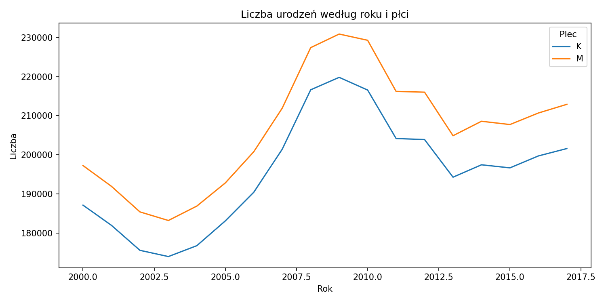
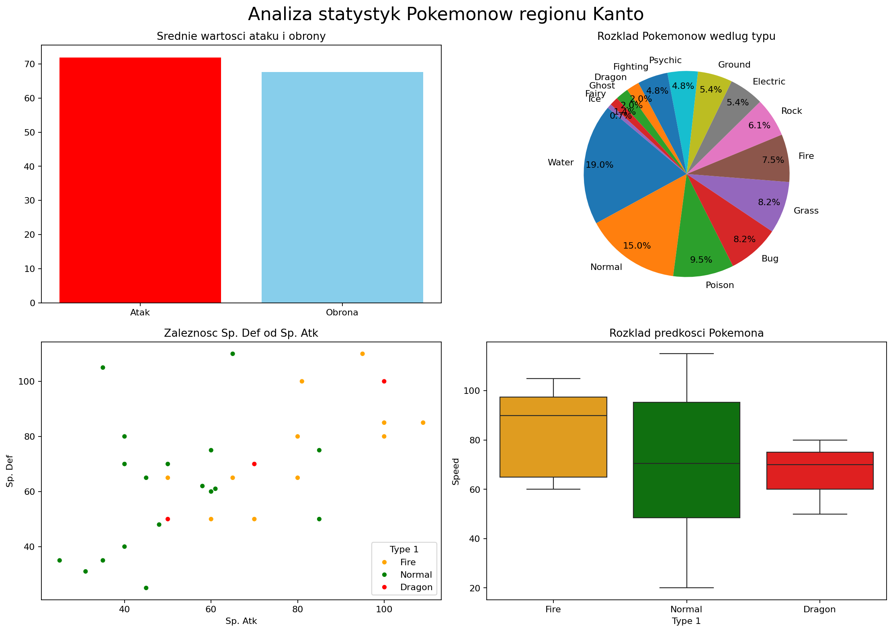

# Analiza i wizualizacja danych

Projekt zawiera ćwiczenia z NumPy, Pandas, Matplotlib i Seaborn oraz
uporządkowany moduł do ładowania, walidowania i agregowania danych.

## Struktura

```text
data/
├── raw/          # dane źródłowe
└── processed/    # dane przetworzone lub wygenerowane wcześniej
lessons/
├── numpy/
├── pandas/
└── visualization/
src/
└── analysis_project/
tests/
notebooks/
figures/
```

## Wymagania

- Python 3.12 lub nowszy,
- pakiety z `requirements.txt`.

Zalecane środowisko wirtualne:

```powershell
python -m venv .venv
.\.venv\Scripts\Activate.ps1
python -m pip install -r requirements.txt
```

## Walidowany moduł analityczny

Moduł `src/analysis_project` udostępnia:

- `load_names` — wczytywanie i walidację danych o imionach,
- `load_orders` — wczytywanie zamówień i konwersję dat oraz kwot,
- `load_pokemon` — wczytywanie i walidację danych Pokemon,
- `births_by_year_and_sex` — agregację urodzeń według roku i płci.

## Testy

Testy korzystają ze standardowego `unittest`:

```powershell
$env:PYTHONPATH = "$PWD\src"
python -m unittest discover -s tests -v
```

Testy sprawdzają między innymi:

- rzeczywiste pliki CSV i XLSX w `data/raw`,
- wymagane kolumny,
- konwersję typów,
- agregacje,
- odrzucanie niepoprawnego schematu danych.

## Wizualizacje

Notebook [notebooks/overview.ipynb](notebooks/overview.ipynb) generuje:

- liczbę urodzeń według roku i płci.

Notebook można uruchomić w Jupyterze:

```powershell
jupyter notebook notebooks\overview.ipynb
```

Wykresy są zapisywane w `figures/`.

### Przykładowe wizualizacje

Poniższe obrazy zostały wygenerowane ponownie z aktualnych zadań w folderze
`lessons`:

#### Analiza urodzeń według płci i roku

Zadanie 6 z `06matplotlib_cz1.py`:



#### Porównanie statystyk Pokemonów

Zadanie 2 z `09seaborn_cz2.py`:



## Ćwiczenia

Każde zadanie w `lessons/` jest osobną funkcją i nie uruchamia się podczas
importowania pliku. Numer zadania wybiera się argumentem `--task`, dzięki
czemu wykresy i wyniki różnych ćwiczeń nie nakładają się na siebie:

```powershell
python lessons\numpy\01numpy_cz1.py --task 6
python lessons\visualization\08seaborn_cz1.py --task 3
```

Domyślnie uruchamia się zadanie 1. Lista dostępnych numerów znajduje się
w komunikacie pomocy każdego pliku:

```powershell
python lessons\visualization\09seaborn_cz2.py --help
```

Lekcje nie są automatycznie uruchamiane przez testy, ponieważ część z nich
otwiera okna z wykresami lub służy do demonstracji.
